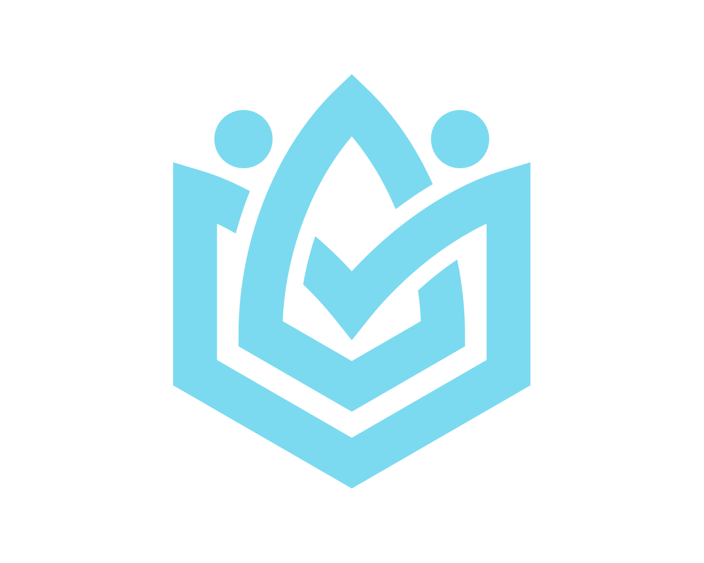

<div align="center">
  
  <h1>ERP Project</h1>
  <p><strong>La operación de tu negocio, en un solo lugar.</strong></p>
  <p>
    Aplicación web ERP en desarrollo, construida con Django y una interfaz responsive
    en tonos teal.
  </p>
</div>

---

## Sobre el proyecto

ERP Project es la base de una plataforma para organizar procesos de negocio desde
un panel central. Actualmente incluye autenticación, administración de usuarios y
roles, un dashboard que muestra los módulos disponibles según los permisos de cada
usuario y el módulo de Materiales.

> **Estado:** en desarrollo. Materiales es el primer módulo funcional; Proveedores
> está en construcción y el resto de tarjetas del dashboard todavía son marcadores.

## Lo que ya tiene

- Inicio y cierre de sesión con el sistema de autenticación de Django.
- Dashboard protegido para usuarios autenticados.
- Usuarios personalizados y asignación de varios roles.
- Permisos por módulo con tres niveles: sin acceso, solo lectura y lectura/escritura.
- Panel de administración de Django para gestionar usuarios, roles y asignaciones.
- **Materiales:** alta, edición y borrado, filtros, paginación y exportación a CSV.
- Interfaz responsive con Tailwind CSS y color principal `#106573`.

### Módulos considerados

| Módulo | Estado |
| --- | --- |
| Materiales | Funcional |
| Proveedores | En construcción |
| Clientes · Compras · Ventas · Inventario · Contabilidad · Reportes | Planeados |

## Tecnologías

- **Python** 3.12
- **Django** 6.1.2
- **SQLite** para desarrollo local
- **Tailwind CSS** mediante CDN
- **DM Sans** desde Google Fonts

La interfaz carga Tailwind y la tipografía desde servicios externos; se necesita
conexión a Internet para que se apliquen esos estilos y fuentes.

## Requisitos

- Python 3.12 o compatible con la versión instalada de Django.
- `pip`.
- Git (opcional, para clonar el proyecto).

## Instalación y ejecución

Desde la carpeta del proyecto:

1. Crea y activa un entorno virtual (la carpeta `venv/` está en `.gitignore`):

   ```bash
   python -m venv venv
   ```

   Linux o macOS:

   ```bash
   source venv/bin/activate
   ```

   Windows PowerShell:

   ```powershell
   venv\Scripts\Activate.ps1
   ```

2. Instala las dependencias:

   ```bash
   python -m pip install -r requirements.txt
   ```

3. Crea la base de datos local y una cuenta administradora. `db.sqlite3` no se
   versiona, así que cada instalación empieza vacía:

   ```bash
   python manage.py migrate
   python manage.py createsuperuser
   ```

4. Entra a `/admin/`, crea al menos un rol con los niveles de acceso que necesites y
   asígnalo a tu usuario. Ser superusuario **no** da acceso a los módulos por sí solo.

5. Inicia el servidor de desarrollo:

   ```bash
   python manage.py runserver
   ```

Abre <http://127.0.0.1:8000/login/> para iniciar sesión. Las rutas principales son:

| Ruta | Uso |
| --- | --- |
| `/login/` | Inicio de sesión |
| `/dashboard/` | Panel principal (requiere autenticación) |
| `/logout/` | Cerrar sesión (solo POST, desde el menú) |
| `/materials/` | Módulo de materiales (requiere permiso) |
| `/admin/` | Administración de Django |

## Roles y permisos

Cada rol puede tener un nivel de acceso independiente para cada módulo:

| Nivel | Valor | Acceso |
| --- | ---: | --- |
| Sin acceso | `0` | El módulo no aparece en el dashboard |
| Solo lectura | `1` | Acceso de consulta |
| Lectura y escritura | `2` | Acceso de consulta y modificación |

Un usuario puede tener más de un rol; en cada módulo se aplica el nivel más alto
entre sus roles. El cálculo está en `users/permissions.py`. Los roles y sus permisos
se administran desde `/admin/`.

## Estructura del proyecto

```text
erp_project/
├── core/
│   ├── static/                 # CSS, logo y JavaScript del menú
│   ├── templates/core/         # Layout base y dashboard
│   ├── context_processors.py   # Permisos y roles en todas las plantillas
│   ├── urls.py
│   └── views.py                # Dashboard
├── docs/                       # Documentación técnica y problemas conocidos
├── erp_project/
│   ├── settings.py             # Configuración Django
│   └── urls.py                 # Rutas principales
├── materials/
│   ├── templates/materials/    # Lista y formulario
│   ├── models.py               # Material
│   ├── forms.py
│   ├── urls.py
│   └── views.py                # Lista, filtros, CSV, alta, edición y borrado
├── suppliers/                  # Proveedores (en construcción)
├── users/
│   ├── templates/users/        # Login
│   ├── models.py               # Usuario, roles y asignaciones
│   ├── permissions.py          # Cálculo de permisos por módulo
│   ├── forms.py
│   ├── urls.py
│   └── views.py                # Login y logout
├── erp_project.code-workspace  # Workspace de VS Code
├── requirements.txt
├── manage.py
└── README.md
```

La documentación técnica detallada está en [`docs/`](docs/README.md).

## Comprobaciones

Verifica la configuración de Django con:

```bash
python manage.py check
```

Ejecuta las pruebas (autenticación, permisos, dashboard y materiales) con:

```bash
python manage.py test
```

## Próximos pasos

- Terminar el módulo de Proveedores.
- Implementar las pantallas y operaciones del resto de módulos.
- Conectar las tarjetas del dashboard con sus rutas definitivas.
- Preparar configuración segura para despliegue.

Los pendientes técnicos están en [`docs/problemas-conocidos.md`](docs/problemas-conocidos.md).

## Nota para despliegues

La configuración actual está orientada al desarrollo local. Antes de desplegar,
configura una clave secreta segura fuera del código, `DEBUG = False`, hosts
permitidos, HTTPS y una base de datos adecuada para producción.
